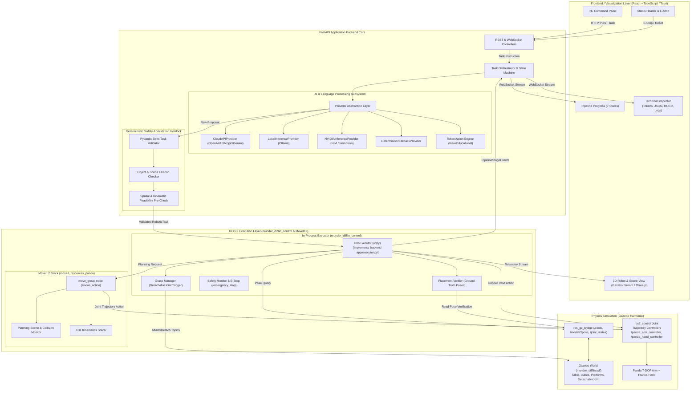
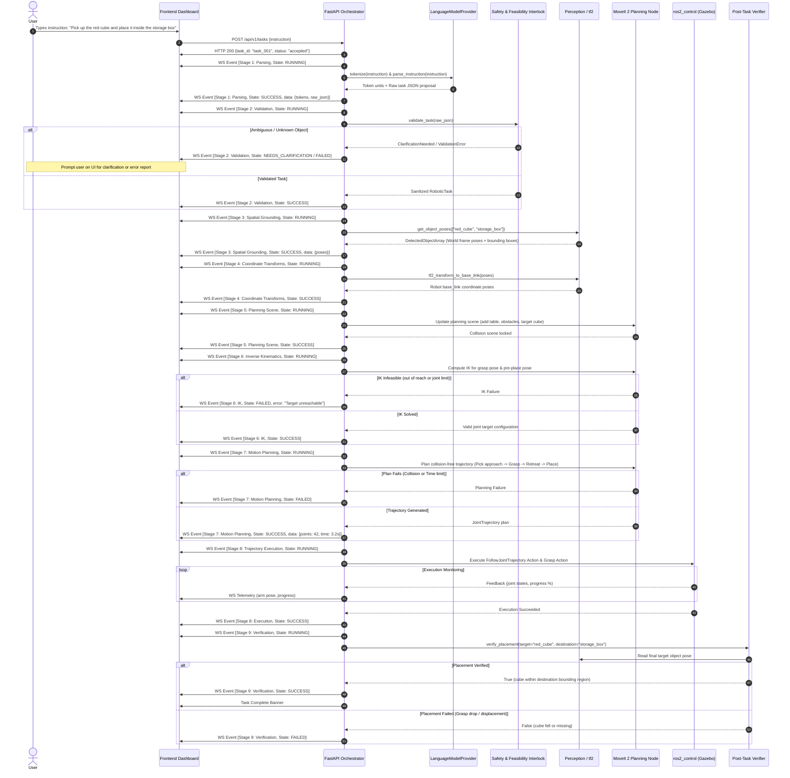
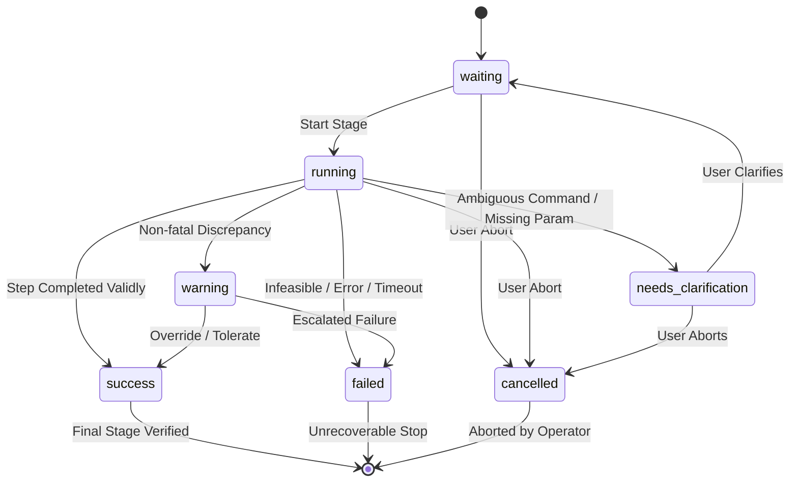

# Munder Difflin: System Architecture Specification
**Version:** 0.1.0-draft  
**Author:** Jim - Architect (A) (`jim-architect-a--mvr0ee0w`)  
**Status:** Approved for Implementation  
**Project Root:** `/home/sudharshan/Documents/Robotic Operation with Prompt Engineering/munder_difflin`  
**Related Documents:** [INTERFACE_CONTRACTS.md](file:///home/sudharshan/Documents/Robotic%20Operation%20with%20Prompt%20Engineering/munder_difflin/docs/INTERFACE_CONTRACTS.md), [DECISIONS.md](file:///home/sudharshan/Documents/Robotic%20Operation%20with%20Prompt%20Engineering/munder_difflin/docs/DECISIONS.md)

---

## 1. System Overview & Core Philosophy

Munder Difflin is an AI-powered natural language robotic manipulation and visualization platform. The platform bridges natural-language instruction and physical robotic execution in simulation (Gazebo Harmonic) with MoveIt 2 and `ros2_control`.

### Architectural Invariants:
1. **Safety Interlock First:** Raw language model outputs **never** command robot controllers or hardware directly. Every natural language interpretation is strictly treated as an unverified proposal that must undergo deterministic schema validation, spatial feasibility checking, collision-aware trajectory planning, and post-execution physical verification.
2. **Transparent Pipeline Observability:** Every computation stage (from tokenization to grasping and verification) produces real-time observable events streamed over WebSockets to the frontend.
3. **Decoupled Modularity:** The core backend parsing and task schemas are independent of ROS 2 runtime, allowing headless unit testing without requiring a live Gazebo instance.
4. **Swappable Perceptual and AI Backends:** Both AI inference providers (Cloud, Local Ollama, NVIDIA NIM, Fallback) and perception sources (simulation ground-truth vs. RGB-D point cloud) implement swappable interfaces without altering core planning logic.

---

## 2. High-Level Component Architecture

---

## 3. End-to-End Data Flow

---

## 4. Pipeline Stages & 7-State Lifecycle

Each computational stage transitions through well-defined states. Project Specification Section 5 defines the **14 Canonical Pipeline Stages** (authoritative single source of truth):

### The 14 Canonical Pipeline Stages:
1. `instruction`: User instruction ingestion, character whitelist validation, and sanitization (SEC-001).
2. `tokenization`: Text tokenization and boundary segmentation (honest IDs / educational approximation).
3. `interpretation`: Language model parsing, prompt isolation (SEC-002), and semantic intent extraction.
4. `structured_task`: Conversion into structured task proposal.
5. `schema_validation`: Strict Pydantic schema validation (`extra="forbid"`, SEC-003).
6. `feasibility`: Deterministic spatial bounds, unknown object rejection, and ambiguity checks (SEC-012).
7. `grounding`: Spatial object and destination pose retrieval from perception interface.
8. `planning_scene`: MoveIt 2 collision scene preparation (adding obstacles, tables, and bins).
9. `ik`: Numerical inverse kinematics resolution for pick, transit, and place poses.
10. `planning`: Collision-aware trajectory generation via MoveIt 2 OMPL (RRTConnect).
11. `trajectory_validation`: Verification of velocity, acceleration, and joint limit constraints.
12. `execution`: Controller trajectory dispatch via ros2_control.
13. `simulation`: Gazebo Harmonic physics simulation, visual motion, and hybrid grasp action.
14. `verification`: Post-execution sensor verification confirming physical placement and release.

### 7 Observable States:
1. `waiting`: The stage is queued awaiting completion of upstream stages.
2. `running`: The stage is actively computing (parsing, solving IK, planning, executing).
3. `success`: The stage successfully completed its verification criteria.
4. `warning`: Stage completed with non-fatal deviations (e.g. trajectory smoothed with high acceleration warning, or perception confidence marginal).
5. `failed`: Deterministic failure encountered (e.g. IK unreachable, collision inevitable, grasp lost).
6. `cancelled`: Execution halted prematurely by operator or emergency stop.
7. `needs_clarification`: Language command requires human-in-the-loop input before proceeding.

---

## 5. Architectural Subsystems Detail

### 5.1 AI & Language Processing Subsystem
- **Decoupled Architecture:** Subsystem is purely functional and stateless regarding robot motion.
- **Provider Interface (`LanguageModelProvider`):** Exposes `parse_instruction`, `tokenize`, and `health_check`.
- **Host Deployment Strategy (ADR-002):** Host hardware has an NVIDIA RTX 3050 Mobile with 4 GB VRAM running `nouveau` driver with no CUDA stack. Local GPU LLMs are infeasible without crashing simulation memory. Primary providers are **Cloud APIs** and **NVIDIA-Hosted NIM APIs** (e.g. Nemotron) over REST, with **DeterministicFallbackProvider** for offline CI testing.
- **Zero-Secret Invariant:** No cloud API credentials or service tokens are transmitted to the frontend or written to git repository. All keys load from environment variables (`OPENAI_API_KEY`, `ANTHROPIC_API_KEY`, `NVIDIA_API_KEY`).

### 5.2 Deterministic Safety & Feasibility Interlock (SEC-012)
- **Authoritative Gateway:** The AI model is an *advisor*; this subsystem is the *mandatory, un-bypassable enforcer*.
- **Lexicon & Bounds Validation:**
  - Known objects lexicon: `["red_cube", "blue_cube", "green_cylinder", ...]`
  - Known destinations: `["storage_box", "marked_platform", "table_left", "table_right"]`
  - Workspace bounding volume: $X \in [-0.8, 0.8]\text{ m}$, $Y \in [-0.8, 0.8]\text{ m}$, $Z \in [0.0, 1.2]\text{ m}$.
- **Ambiguity Interception:** Instructions referencing underspecified directions ("left", "away", "faster") without explicit reference frames are rejected early with `needs_clarification`.

### 5.3 Perception & Spatial Grounding Subsystem
- **Swappable Architecture:** Normalized under `munder_difflin_msgs/msg/DetectedObjectArray`.
- **Mode A (Simulation Ground Truth):** Ingests raw model poses directly from Gazebo physics world via `ros_gz_bridge`. Guaranteed noise-free baseline for motion planning development. Explicitly reported as `simulation_ground_truth`.
- **Mode B (RGB-D Vision Pipeline):** Subscribes to simulated depth camera topics (`/camera/depth/image_raw`, `/camera/color/image_raw`). Applies pointcloud segmentation, bounding box computation, and publishes detected centroid with confidence score.
- **Coordinate Transformations (`tf2`):** Transforms all bounding boxes and target pick poses into the robot's base coordinate frame (`panda_link0`).

### 5.4 Motion Planning Subsystem (MoveIt 2)
- **Primary Manipulator (ADR-006 & ADR-012):** Franka Emika Panda (7-DOF) with native Franka Hand parallel jaw gripper. Packages specified from official ROS 2 Jazzy apt binaries: `ros-jazzy-moveit-resources-panda-description` and `ros-jazzy-moveit-resources-panda-moveit-config` (superseding `franka_ros2` per ADR-012 to avoid `libfranka` hardware mocks and `fer_*` joint renames). Fallback: Universal Robots UR5e (`ros-jazzy-ur-simulation-gz`).
- **Planning Pipeline:** MoveIt 2 OMPL (defaulting to RRTConnect or Pilz industrial planner for linear Cartesian paths).
- **Planning Groups:** `panda_arm` (7 joints: `panda_joint1..7`) and `panda_hand` (2 finger joints: `panda_finger_joint1..2`).
- **Base and Tool Frames:** Base is `panda_link0`, tool tip is `panda_hand`.
- **Planning Scene Representation:** Dynamic collision objects representing table, storage bins, and obstacle objects (e.g., `blue_cube` when instructed "avoid blue cube").
- **Kinematics:** KDL or PickNik TrackIK kinematics solver plugin for 7-DOF redundancy resolution.

### 5.5 Control & Physics Execution Subsystem (Gazebo Harmonic & `ros2_control`)
- **Physics Engine:** Gazebo Harmonic (gz-sim 8) with DART physics. (Isaac Sim is designated as an optional cloud extension per ADR-010).
- **Simulation Bringup:** `ros2 launch munder_difflin_bringup sim.launch.py` (verified headless Gazebo execution with `gz_ros2_control`).
- **Active Controllers (Verified Live in Simulation):**
  - `panda_arm_controller`: `joint_trajectory_controller/JointTrajectoryController` active on `/panda_arm_controller/follow_joint_trajectory`.
  - `panda_hand_controller`: `position_controllers/GripperActionController` active on `/panda_hand_controller/gripper_cmd`.
  - `joint_state_broadcaster`: active publishing to `/joint_states`.
- **Hybrid Grasping Architecture (ADR-007):**
  1. *Physical friction grasp* (compliant gripper fingers with realistic contact coefficients).
  2. *Simulator attach plugin* (Gazebo `gz-sim-detachable-joint-system`) dynamically triggered upon verified finger closure to lock the object rigidly during transit and prevent acceleration drops.

### 5.6 Post-Execution Verification Subsystem
- **Physical Verification:** After executing place and release:
  1. Controller confirms gripper release open state.
  2. Perception system re-evaluates the target object pose.
  3. Centroid distance to destination boundary is computed. If $|P_{\text{obj}} - P_{\text{dest}}| < \epsilon_{\text{dest}}$, mark task `SUCCESS`; otherwise mark `FAILED`.
- **No False Positives:** A task is never marked successful merely because MoveIt completed trajectory planning or ros2_control finished sending joint positions.

---

## 6. Failure Modes & Recovery Matrix

| Failure Mode | Detected At Stage | System Action | Recovery Strategy |
| :--- | :--- | :--- | :--- |
| **Malformed LLM Output** | `interpretation` | Provider validation retry (x2) | Fallback to `DeterministicFallbackProvider` or report parsing error |
| **Ambiguous Direction ("move left")** | `feasibility` | Transition to `needs_clarification` | Request reference frame & destination selection from user |
| **Object Not Found in Scene** | `grounding` | Transition to `failed` | Alert user: object missing from perception scene; refuse motion |
| **IK Infeasible / Joint Limits** | `ik` | Transition to `failed` | Log reachable envelope violation; notify user target is out of reach |
| **Path Collision Detected** | `planning` | Attempt secondary planner config | Retry with higher clearance margin; if still blocked, fail safely |
| **Execution Collision / Obstacle** | `execution` | Immediate controller abort | Freeze arm, publish emergency warning, require operator reset |
| **Object Dropped Mid-transit** | `verification` | Verification failure detected | Alert user of grasp failure; offer return-to-home recovery motion |
| **Gazebo Bridge Disconnect** | Any stage | Heartbeat monitor trips | Inhibit all motion commands; transition UI header to Disconnected |

---

## 7. Security Architecture & Threat Mitigations (SEC Findings)

In direct compliance with Security Engineer Dwight's audit (`docs/project/SECURITY_FINDINGS.md`):

1. **SEC-001 (Untrusted NL Input):**
   - Natural language input capped at 500 characters.
   - Non-printable and shell control characters stripped prior to tokenization.
2. **SEC-002 & SEC-003 (Prompt Injection & Model Output Validation - CRITICAL):**
   - System prompts are strictly segregated from user inputs using OpenAI/Anthropic/NIM role separation.
   - Model outputs are gated through strict Pydantic schemas (`extra="forbid"`) without dynamic code execution or `eval()`.
3. **SEC-008 (Install Scripts):**
   - All installation and setup scripts must be idempotent, hash-check remote artifacts, and require interactive human authorization for `sudo`.
4. **SEC-011 (ROS 2 DDS Network Isolation):**
   - ROS 2 Jazzy DDS configured to localhost only (`export ROS_LOCALHOST_ONLY=1`).
   - Domain ID pinned explicitly (`export ROS_DOMAIN_ID=42`).
   - Only explicitly declared bridge topics configured in `ros_gz_bridge`.
5. **SEC-012 (Deterministic Safety Gateway - RELEASE BLOCKER):**
   - The safety interlock (`app/validation/`) is architecturally un-bypassable.
   - Rejects ungrounded objects, negative clearances, coordinates outside workspace bounds ($X, Y \in [-0.8, 0.8]\text{ m}, Z \in [0.0, 1.2]\text{ m}$), and underspecified directional commands without explicit reference frames.
6. **SEC-013 (E-Stop Verification - RELEASE BLOCKER):**
   - Dedicated endpoint `POST /api/v1/simulation/e-stop` and service `/munder_difflin/safety/emergency_stop`.
   - E-Stop confirmation is strictly verified by asserting joint velocities $|\dot{q}| < 1e-4\text{ rad/s}$ and controller state `STOPPED`. A GUI button click without controller verification is prohibited.
7. **SEC-015 (Desktop Application Hardening):**
   - For Electron/Tauri desktop packaging: `contextIsolation: true`, `nodeIntegration: false`, strict CSP restricting connections exclusively to `http://localhost:8000` and `ws://localhost:8000`.

---

## 8. Development Quality Gates Alignment

- **Gate A (Architecture):** Covered by this specification, [INTERFACE_CONTRACTS.md](file:///home/sudharshan/Documents/Robotic%20Operation%20with%20Prompt%20Engineering/munder_difflin/docs/INTERFACE_CONTRACTS.md), and [DECISIONS.md](file:///home/sudharshan/Documents/Robotic%20Operation%20with%20Prompt%20Engineering/munder_difflin/docs/DECISIONS.md).
- **Gate B (Implementation):** Pam (D) delivers `backend/` core with isolated unit tests; Andy (I) delivers `ros2_ws/` workspace packages.
- **Gate C (Integration):** ROS 2 action interfaces connected to FastAPI WebSocket streaming pipeline.
- **Gate D (Testing):** Angela (T) verifies acceptance tests A through J.
- **Gate E (Security):** Dwight (SEC) audits credential handling, untrusted model output safety interlocks, and dependency vulnerabilities.
- **Gate F (Release):** Stanley (REL) confirms packaging, reproducible launch scripts, and release criteria.

---

## 9. Known Architectural Limitations

In compliance with ADR-013 and verified project delivery:
1. **Single-Process Execution Coupling:**
   Task execution, grasp state tracking, placement verification, and perception parsing run in the same Python process as `RosExecutor` (`munder_difflin_control.ros_executor`). They are not independently restartable microservice nodes. If the executor process terminates, active execution tracking halts.
2. **Perception Ground-Truth Baseline:**
   Perception currently ingests simulation ground-truth poses directly from Gazebo (`/model/<id>/pose`). This is explicitly exposed as `simulation_ground_truth` and does not claim to be a vision-based pointcloud segmentation pipeline. The interface (`ObjectPoseSource`) is swappable for future RGB-D vision nodes.
3. **Local GPU Inference Infeasibility:**
   Due to host hardware constraints (4 GB VRAM on RTX 3050 Mobile with `nouveau` driver), local LLM inference is disabled. System relies on Cloud APIs, remote NVIDIA NIM endpoints, and a deterministic offline fallback parser.
